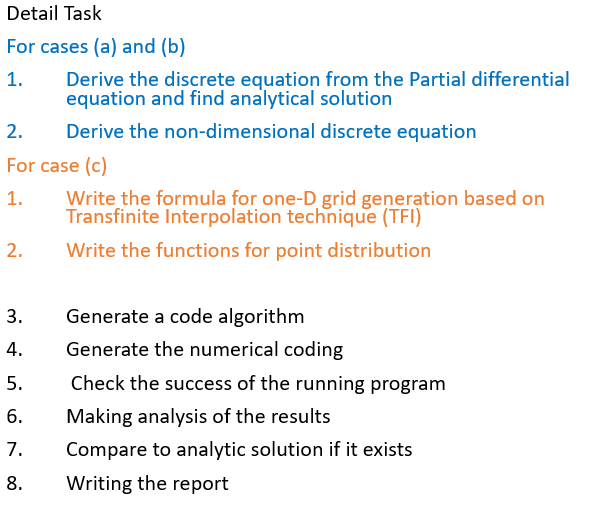

# Code Development for Final Project AE4010 Introduction to Computational Fluid Dynamics

## Group 6 (Case C)

- 13123063 (Muhammad Satir Muzakki)
- 13123069 (Muhammad Hanif Hafizhan)

For 1-D grid generation, make increased points (min. 2 different point numbers) and various point distributions on a line (Case C)

Task for Case C:

